<div align="center">

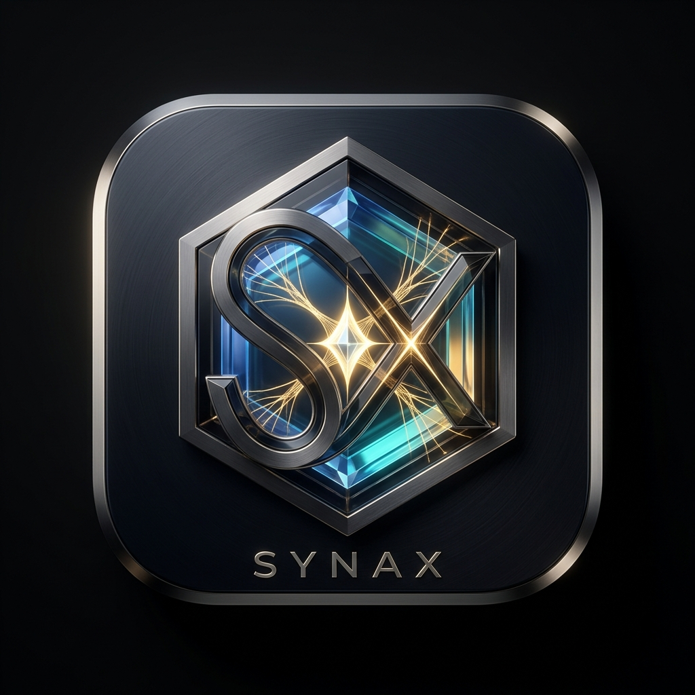

# 🚀 SYNAX-OMNI v6.0 — Süper-LLM & 3D Pixar-Tycoon Agent Office Ekosistemi
### **Dr. Ömer Faruk Aydın (`@ofaemd-creator`) · Klinik Karar Destek, Otonom Biyomedikal Sıfır-Sapma (`V_{k+1} < V_k`), 0-ULP Formal Doğrulama ve Çoklu-Ajan Yapay Zeka Stüdyosu**

[](https://synaxcode.com)
[](https://synaxcode.org)
[](https://synaxcode.online)
[](https://github.com/ofaemd-creator/synax-agent-office/releases/latest)
[](https://github.com/ofaemd-creator/synax-vscode-chat)

</div>

---

## 🎬 1. SYNAX-OMNI v6.0 — 3D Pixar + Tycoon İnteraktif Ajan Ofisi Sahnesi

> **Gerçek Bir Yapay Zeka Aracı & Süper-LLM:** SYNAX-OMNI v6.0; **Groq LPU (`Qwen-3.8 27B` / `GPT-OSS 120B`)**, **Canlı NCBI PubMed `efetch` Tam Makale Özeti Çekici**, **Wikipedia TR/EN & CrossRef DOI Akademik RAG**, **Canlı Python Code Interpreter Sandbox** ve **Claude Artifacts / Canvas** çalışma tezgahını **60 FPS Pixar-Tycoon 3D Ajan Ofisi** içinde birleştirir.

<div align="center">
  <a href="https://synaxcode.com">
    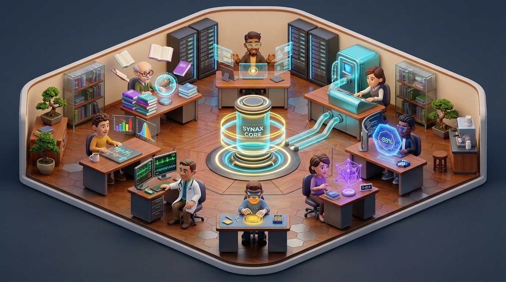
  </a>
</div>

---

## 🧑‍🔬 2. 3D Pixar-Tycoon Ajanlar Sayfası — 8 Uzman Yapay Zeka Karakteri ve Görev Masaları

Ofisteki **8 Pixar uzman karakterinin** her birine **3D sahnede tıklayarak kamerayla yakınlaşabilir**, kendi yapay zeka hesabınızı (**Groq LPU, Anthropic Claude Code, OpenAI Codex, Google Gemini, OpenRouter, Yerel Ollama**) bağlayabilir ve her ajana bağımsız görev atayabilirsiniz:

<table>
  <tr>
    <td align="center" width="25%">
      <br/>
      <b>👑 Masa 1: Baş Mimar SYNAX-LLM</b><br/>
      <sub><b>Motor:</b> Groq LPU Qwen-3.8 27B + ReAct</sub><br/>
      <sub>Türkçe Doğal Dil Muhakemesi, 8-Ajan Görev Dağıtımı & Claude Artifact Sentezi</sub>
    </td>
    <td align="center" width="25%">
      <br/>
      <b>📚 Masa 2: Prof. Scholar (PRISMA)</b><br/>
      <sub><b>Motor:</b> NCBI PubMed efetch + CrossRef</sub><br/>
      <sub>Canlı PubMed Tam Özet Tarama, PRISMA 2020 Akışı, PICO & Vancouver/BibTeX</sub>
    </td>
    <td align="center" width="25%">
      <br/>
      <b>📊 Masa 3: Dr. Biostat (Meta-Analiz)</b><br/>
      <sub><b>Motor:</b> Python Code Interpreter</sub><br/>
      <sub>DerSimonian-Laird Havuzlanmış Etki (Hedges g), I² Heterojenite & Forest Plot</sub>
    </td>
    <td align="center" width="25%">
      <br/>
      <b>🩺 Masa 4: Dr. Lyapunov (Sıfır-Sapma)</b><br/>
      <sub><b>Motor:</b> SYNAX Biomed Autocal</sub><br/>
      <sub>Yoğun Bakım EKG, IBP & SpO2 Sensörlerinde V_(k+1) &lt; V_k Otonom Öz-Kalibrasyon</sub>
    </td>
  </tr>
  <tr>
    <td align="center" width="25%">
      <br/>
      <b>🛡️ Masa 5: Master E-Graph (0-ULP)</b><br/>
      <sub><b>Motor:</b> SYNAX Formal Prover</sub><br/>
      <sub>Cebirsel E-Graph Doyurma & IEEE-754 NaN/Inf Bağışıklık Kanıt Sertifikası</sub>
    </td>
    <td align="center" width="25%">
      <br/>
      <b>⚡ Masa 6: Capt. Shield (-%88.4 Token)</b><br/>
      <sub><b>Motor:</b> SYNAX Token Shield</sub><br/>
      <sub>Claude Code & OpenAI Codex İçin AST Kod İskeletleştirici ve Kota Kalkanı</sub>
    </td>
    <td align="center" width="25%">
      <br/>
      <b>🧠 Masa 7: Agent Vault (SHA-256)</b><br/>
      <sub><b>Motor:</b> SYNAX Context Vault</sub><br/>
      <sub>Ajanlar Arası &lt;180 Tokenlık Kriptografik Bağlam Devir Kapsülü (%99.7 Tasarruf)</sub>
    </td>
    <td align="center" width="25%">
      <br/>
      <b>🔩 Masa 8: Chief Silicon (5-Çip)</b><br/>
      <sub><b>Motor:</b> Clang -O3 & Multi-Silicon</sub><br/>
      <sub>ARM64 NEON, x86 AVX2, LLVM IR, ANSI C99 ve Q16.16 Biyomedikal MCU Üretimi</sub>
    </td>
  </tr>
</table>

---

## 🖼️ 3. SYNAX-OMNI v6.0 Modüler Depoları ve Görsel Mimarisi (Ajanlar Sayfasının Devamı)

Aşağıdaki tüm modüller hem bağımsız açık-kaynak GitHub depoları olarak hem de `synax` ana çatısı altında birleşik olarak çalışmaktadır:

### 🏛️ 3.1. SYNAX 3D İzometrik Ajan Ofisi & Çoklu-Ajan Görev Merkezi (`synax-agent-office`)
> **Depo:** [`ofaemd-creator/synax-agent-office`](https://github.com/ofaemd-creator/synax-agent-office) · **Canlı:** [`https://synaxcode.com`](https://synaxcode.com)

<div align="center">
  <a href="https://github.com/ofaemd-creator/synax-agent-office">
    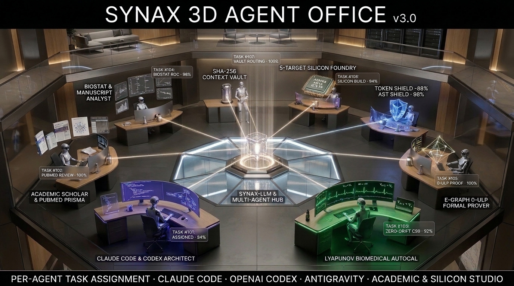
  </a>
</div>

---

### 📚 3.2. Akademik PRISMA 2020, Biyoistatistik & Claude/Codex Beceri Paketi (`synax-academic-research`)
> **Depo:** [`ofaemd-creator/synax`](https://github.com/ofaemd-creator/synax) · **Canlı PubMed `efetch` + Meta-Analiz + Forest Plot + IMRaD Sentezi**

<div align="center">
  <a href="https://github.com/ofaemd-creator/synax">
    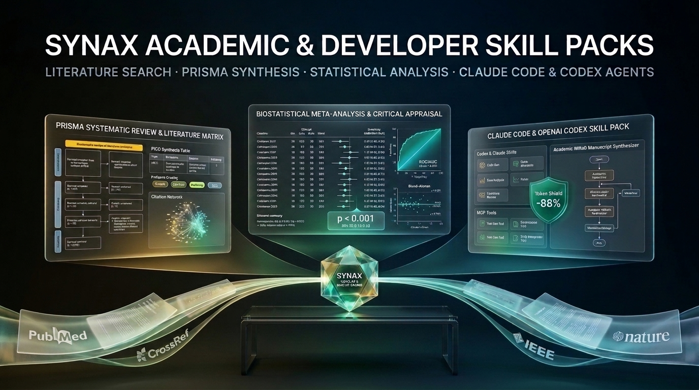
  </a>
</div>

---

### 🧠 3.3. SYNAX-LLM Türkçe & İngilizce Dil Modeli Dökümhanesi (`synax-llm`)
> **Depo:** [`ofaemd-creator/synax`](https://github.com/ofaemd-creator/synax) · **Türkçe Eklemeli Morfoloji + ReAct Araç Çağırma + Groq LPU Köprüsü**

<div align="center">
  <a href="https://github.com/ofaemd-creator/synax">
    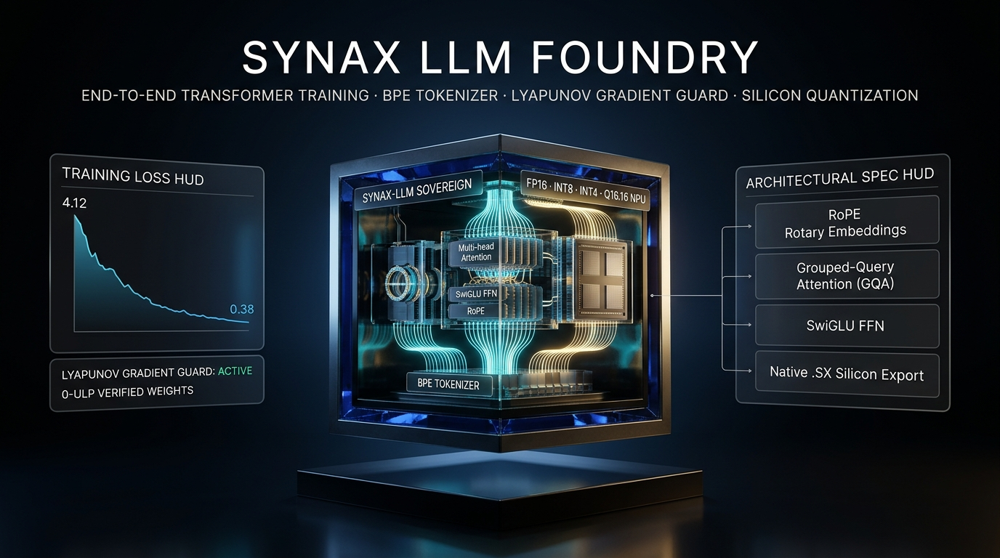
  </a>
</div>

---

### 🩺 3.4. Biyomedikal Otonom Sıfır-Sapmalı (`V_{k+1} < V_k`) Öz-Kalibrasyon (`synax-biomed-autocal`)
> **Depo:** [`ofaemd-creator/synax-biomed-autocal`](https://github.com/ofaemd-creator/synax-biomed-autocal) · **EKG, İnvaziv Kan Basıncı (IBP), Ventilatör ve SpO2 Sensörlerinde Manuel Kalibrasyona Son (%99.98 Sapma Bastırma)**

<div align="center">
  <a href="https://github.com/ofaemd-creator/synax-biomed-autocal">
    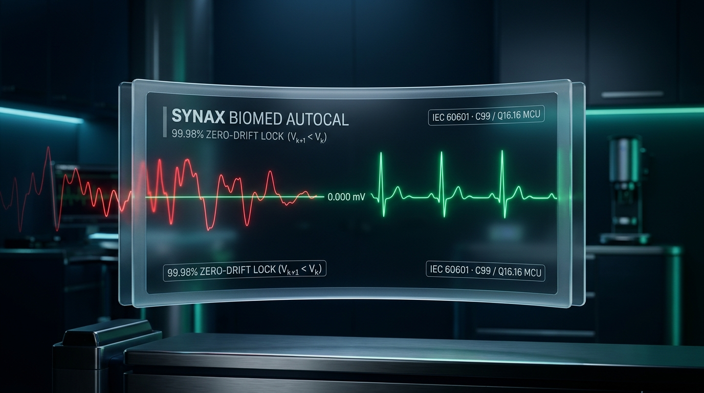
  </a>
</div>

---

### 🛡️ 3.5. SYNAX Token Shield — -%88.4 AI Token Sıkıştırıcı & AST İskeletleştirici (`synax-token-shield`)
> **Depo:** [`ofaemd-creator/synax-token-shield`](https://github.com/ofaemd-creator/synax-token-shield) · **Claude Code, OpenAI Codex, Cursor ve Antigravity Kotalarını Koruyan Sıfır-Bağımlılıklı Kalkan**

<div align="center">
  <a href="https://github.com/ofaemd-creator/synax-token-shield">
    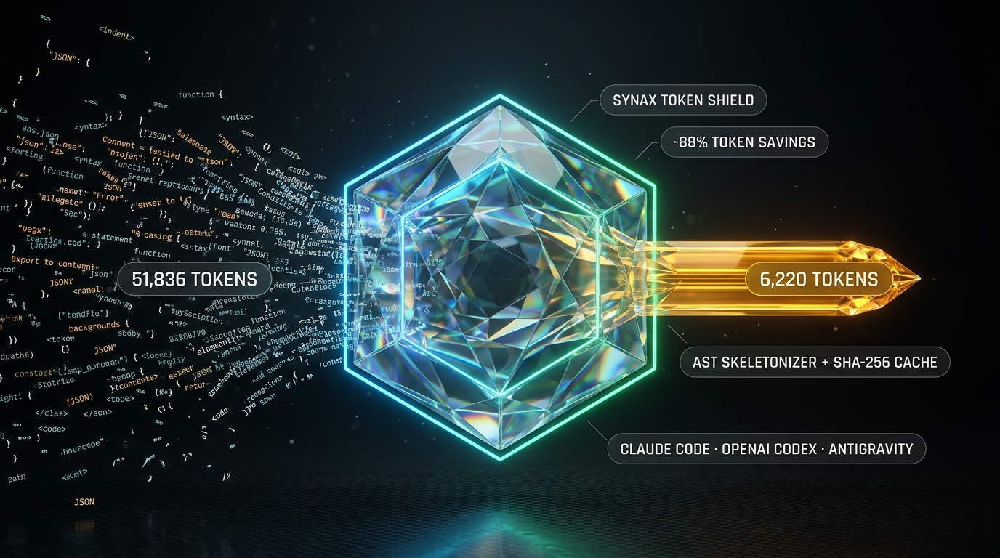
  </a>
</div>

---

### 🔐 3.6. SYNAX Context Vault — SHA-256 Kriptografik Ajan Hafıza Kasası (`synax-context-vault`)
> **Depo:** [`ofaemd-creator/synax-context-vault`](https://github.com/ofaemd-creator/synax-context-vault) · **50.000 Tokenlık Depo Okumalarını &lt;180 Tokenlık SHA-256 Kapsülüne İndirger (%99.7 Tasarruf)**

<div align="center">
  <a href="https://github.com/ofaemd-creator/synax-context-vault">
    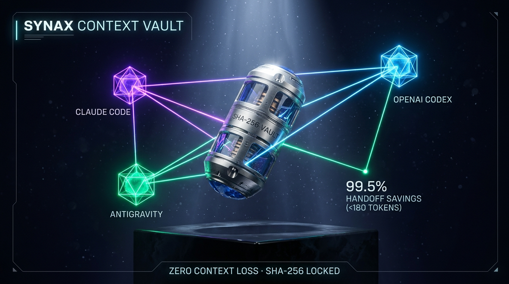
  </a>
</div>

---

### 💬 3.7. SYNAX VS Code, Cursor, Windsurf & Antigravity IDE Eklentisi (`synax-vscode-chat`)
> **Depo:** [`ofaemd-creator/synax-vscode-chat`](https://github.com/ofaemd-creator/synax-vscode-chat) · **IDE İçinde 3D Pixar-Tycoon Ajan Ofisi ve Türkçe Süper-LLM**

<div align="center">
  <a href="https://github.com/ofaemd-creator/synax-vscode-chat">
    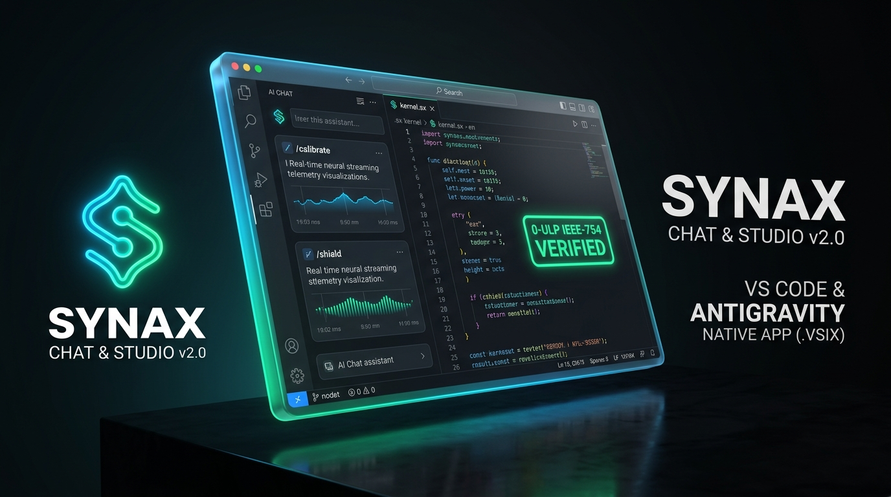
  </a>
</div>

---

### ⚖️ 3.8. SYNAX E-Graph Cebirsel Doyurma & 0-ULP Formal Kanıtlayıcı (`synax-egraph-prover`)
> **Depo:** [`ofaemd-creator/synax-egraph-prover`](https://github.com/ofaemd-creator/synax-egraph-prover) · **Soyut Aralık Yorumlama (Interval Abstract Interpretation) & IEEE-754 Bağışıklığı**

<div align="center">
  <a href="https://github.com/ofaemd-creator/synax-egraph-prover">
    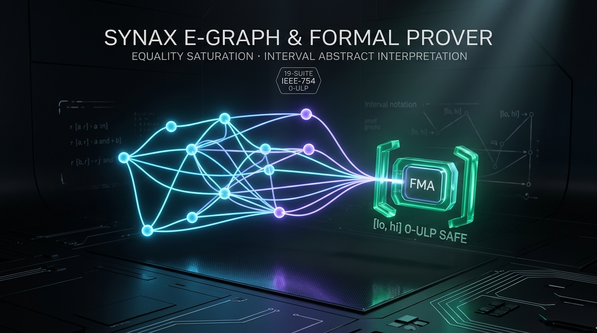
  </a>
</div>

---

### 🔩 3.9. SYNAX 5-Çipli Çoklu-Silikon Donanım Sentez Stüdyosu (`synax-studio`)
> **Depo:** [`ofaemd-creator/synax-studio`](https://github.com/ofaemd-creator/synax-studio) · **Tek `.sx` Çekirdeğinden ARM64 NEON, x86 AVX2, LLVM IR, ANSI C99 ve Q16.16 MCU Üretimi**

<div align="center">
  <a href="https://github.com/ofaemd-creator/synax-studio">
    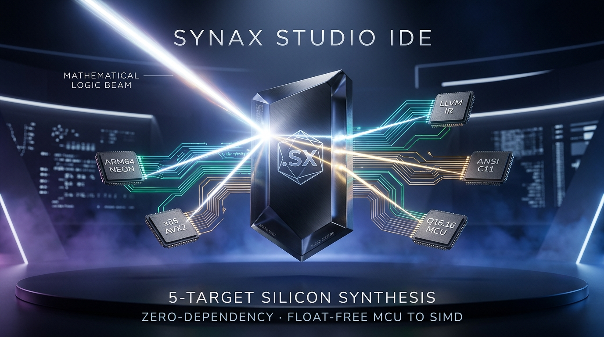
  </a>
</div>

---

### 📱 3.10. SYNAX Telegram Mobil Ajan Köprüsü (`synax-telegram-bot`)
> **Depo:** [`ofaemd-creator/synax-telegram-bot`](https://github.com/ofaemd-creator/synax-telegram-bot) · **Telegram Üzerinden `/status`, `/check`, `/run`, `/egraph`, `/prove`, `/code` Komutlarıyla Mobil Erişim**

<div align="center">
  <a href="https://github.com/ofaemd-creator/synax-telegram-bot">
    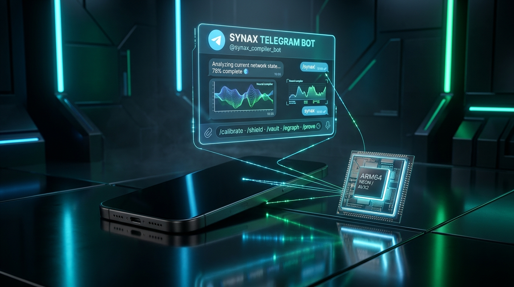
  </a>
</div>

---

## 💻 4. Herhangi Bir Bilgisayara (macOS, Windows, Linux) ve IDE'ye Tek Komutla Kurulum

```bash
# 1. macOS & Linux Masaüstü Uygulaması + Claude Code & OpenAI Codex 8 Ajan Kurulumu:
curl -fsSL https://raw.githubusercontent.com/ofaemd-creator/synax-agent-office/main/install-desktop.sh | bash

# 2. Windows PowerShell Masaüstü Uygulaması Kurulumu:
irm https://raw.githubusercontent.com/ofaemd-creator/synax-agent-office/main/install-desktop.ps1 | iex
```

---

## 📦 5. `@ofaemd-creator` 9 Modüler Açık-Kaynak SYNAX Deposu Tablosu

| # | GitHub Deposu | Kategori | Canlı Bağlantı |
|---|---|---|---|
| **1** | [`ofaemd-creator/synax`](https://github.com/ofaemd-creator/synax) | **SYNAX-OMNI v6.0 Ana Çatı & Derleyici** | [`synaxcode.com`](https://synaxcode.com) |
| **2** | [`ofaemd-creator/synax-agent-office`](https://github.com/ofaemd-creator/synax-agent-office) | **3D Pixar-Tycoon 8-Ajan Ofisi & Masaüstü Uygulaması** | [`synaxcode.com/office.html`](https://synaxcode.com/office.html) |
| **3** | [`ofaemd-creator/synax-vscode-chat`](https://github.com/ofaemd-creator/synax-vscode-chat) | **VS Code, Cursor, Windsurf & Antigravity Eklentisi** | [`.vsix İndir`](https://github.com/ofaemd-creator/synax-vscode-chat/releases/latest) |
| **4** | [`ofaemd-creator/synax-biomed-autocal`](https://github.com/ofaemd-creator/synax-biomed-autocal) | **Biyomedikal Sıfır-Sapma (`V_{k+1} < V_k`) Öz-Kalibrasyon** | [`synaxcode.org`](https://synaxcode.org) |
| **5** | [`ofaemd-creator/synax-token-shield`](https://github.com/ofaemd-creator/synax-token-shield) | **-%88.4 AI Token Sıkıştırıcı & AST İskeletleştirici** | [`GitHub`](https://github.com/ofaemd-creator/synax-token-shield) |
| **6** | [`ofaemd-creator/synax-context-vault`](https://github.com/ofaemd-creator/synax-context-vault) | **SHA-256 Kriptografik Ajan Hafıza Kapsülü** | [`GitHub`](https://github.com/ofaemd-creator/synax-context-vault) |
| **7** | [`ofaemd-creator/synax-egraph-prover`](https://github.com/ofaemd-creator/synax-egraph-prover) | **E-Graph Doyurma & 0-ULP Formal Kanıtlayıcı** | [`GitHub`](https://github.com/ofaemd-creator/synax-egraph-prover) |
| **8** | [`ofaemd-creator/synax-studio`](https://github.com/ofaemd-creator/synax-studio) | **5-Çipli Çoklu-Silikon Donanım Sentez Stüdyosu** | [`synaxcode.online`](https://synaxcode.online) |
| **9** | [`ofaemd-creator/synax-telegram-bot`](https://github.com/ofaemd-creator/synax-telegram-bot) | **Telegram Mobil Ajan & Derleyici Köprüsü** | [`@synax_compiler_bot`](https://t.me/synax_compiler_bot) |

---

<div align="center">
  <b>Kurucu & Baş Mimar:</b> Dr. Ömer Faruk Aydın (<code>@ofaemd-creator</code>) · MIT Lisansı · 2026
</div>
